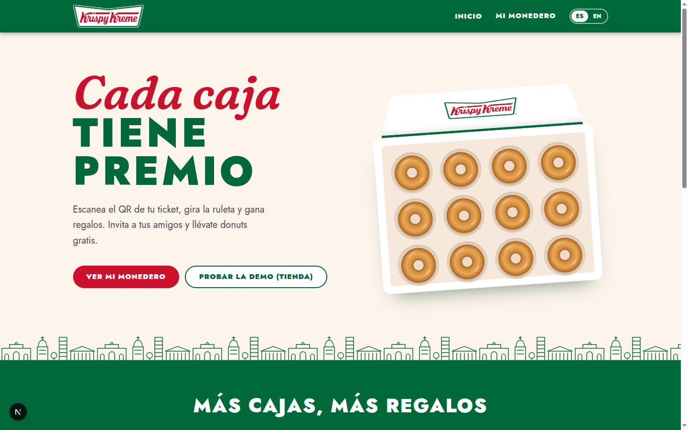
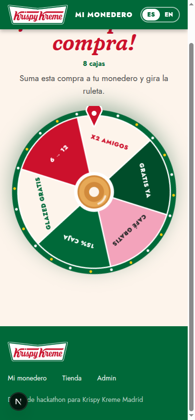
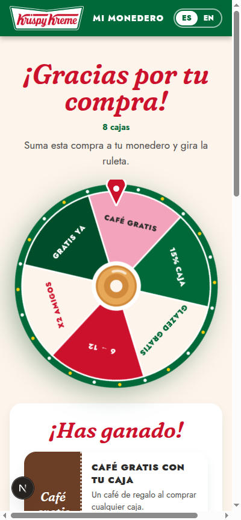
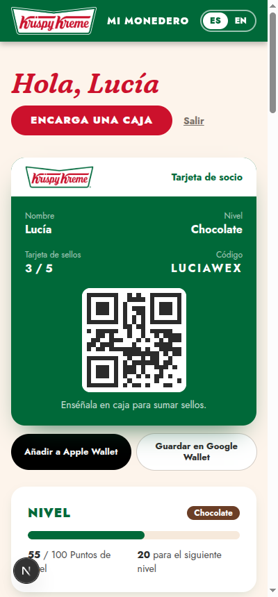
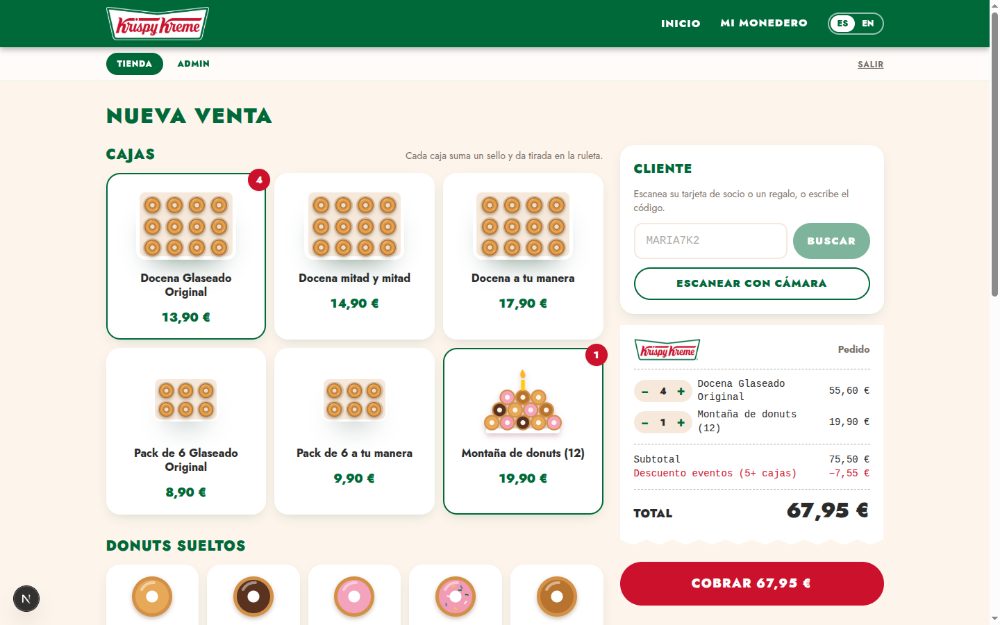
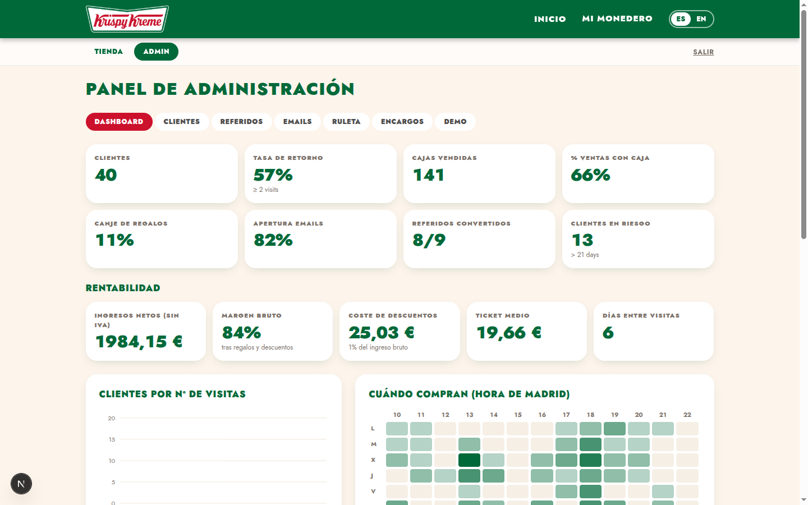

# Krispy Kreme Madrid · Rewards

[🇬🇧 English](README.md) · 🇪🇸 Español · **Demo: https://hack2026.tatuck.com**

App web de fidelización y referidos creada para el **hackathon de Krispy Kreme organizado por [STARTComillas](https://www.instagram.com/startcomillas/)** (Universidad Pontificia Comillas, Madrid, octubre de 2026).

**Reto:** muchos clientes de Krispy Kreme compran una vez y no vuelven, y la mayoría de las ventas son donuts sueltos. Este prototipo convierte el ticket en el inicio de una relación: cada compra da premios, y esos premios empujan a comprar **cajas** y a traer amigos.



## Cómo funciona

1. **QR del ticket → ruleta de regalos.** Cada ticket lleva un QR. El cliente lo escanea, se registra con su email y gira una ruleta que favorece los premios en caja.
2. **Monedero.** Tarjeta de socio con QR, tarjeta de sellos (5 cajas → la 6ª gratis), progreso de nivel (Original / Chocolate / Gold), regalos y encargos de cajas.
3. **Referidos.** El amigo tiene un 20% en su primera caja. Quien invita gana un donut por cada amigo y una docena gratis cada 3 amigos.
4. **Automatizaciones.** Ofertas de cumpleaños, emails de recuperación para clientes que dejan de venir, caducidad de regalos y una puntuación de valor de 0 a 100 por cliente.
5. **Caja de tienda.** El dependiente toca los productos, escanea el QR del cliente para aplicar sus premios, cobra e imprime el ticket con su QR.
6. **Panel de administración.** KPIs (tasa de retorno, % de ventas con caja, margen, coste de descuentos), clientes, árbol de referidos, emails, probabilidades de la ruleta y una "máquina del tiempo" para la demo.

| Ruleta | Premio | Monedero |
|---|---|---|
|  |  |  |




## Tecnología

Next.js 16 · React 19 · Tailwind v4 · Drizzle ORM sobre SQLite/Turso · Resend para emails. La app está en [`web/`](web/). Su [README](web/README.md) explica la instalación, el guion de demo de 5 minutos y el despliegue.

```bash
cd web && npm install && cp .env.example .env.local && npm run db:push && npm run dev
```

PIN de tienda/admin: `1234`.

En la demo pública ese PIN abre el kiosko y el panel de admin, pero no permite borrar los datos: eso requiere el `ADMIN_PIN` secreto. La base de datos tiene un tope (500 clientes y 3.000 tickets por defecto); al llenarse se rechazan altas nuevas y el cron diario la reinicia con datos de ejemplo.

## Licencia

[MIT](LICENSE).

> Prototipo de hackathon. Sin relación oficial con Krispy Kreme.
